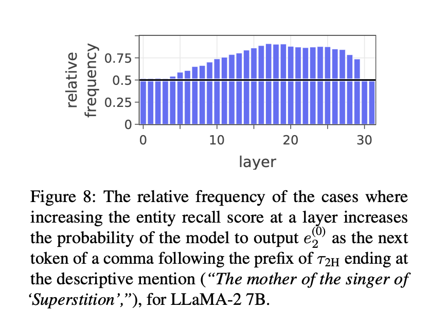
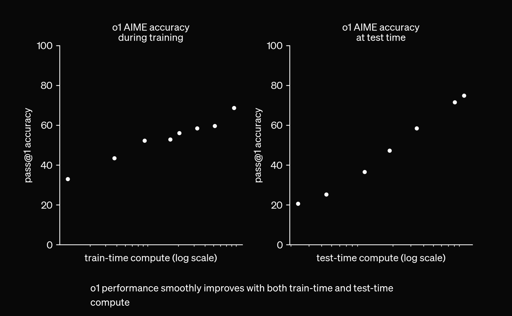

## Purpose

This page is not a post. It exists so the design can be judged on things the two real posts do not use yet: notes, code, tables, lists and captioned figures. The prose is filler, written to have a realistic rhythm of short and long sentences, some *emphasis*, some **strong emphasis**, an [inline link](https://gwern.net/sidenote), and the occasional `inline_code()` span sitting inside a line of serif text.

## Small touches

Acronyms are set in real small caps, so a sentence about LLMs, GPUs and the MLP inside GPT-2 keeps an even colour instead of shouting; the plural *s* stays lowercase, and <span class="nocaps">NASA</span> can opt out with a `nocaps` span. A spaced hyphen - like this one - is set as an en dash, and a dash never begins a line.

Links to a few familiar places carry a small mark: a paper on [arXiv](https://arxiv.org/abs/1706.03762), an article on [Wikipedia](https://en.wikipedia.org/wiki/Small_caps), a repository on [GitHub](https://github.com/karpathy/nanoGPT), a post on [X](https://x.com/stochasticchasm), and anything that is [a PDF](https://ekinakyurek.github.io/papers/ttt.pdf). Other [links](https://gwern.net/design) are left alone.

"A paragraph that opens with a quotation mark hangs it in the margin," as the old compositors did, so the left edge of the text stays optically straight.

Hover over a heading and its section number, in the gutter, becomes a link to that section.

## Numerals

A second paragraph, so paragraph spacing can be seen. Numbers in running text are set as old-style figures, so 2017, 65,536 and 1.8 trillion sit at the height of the lowercase rather than shouting; headings, tables and anything monospaced use lining figures instead, and so does a name that mixes digits and letters, such as o1 or GPT-4o, where an old-style 1 would read as a capital I and the *o* as a zero.

## Notes in the margin

A footnote is written in ordinary Markdown.[^plain] On a wide screen it is lifted into the right margin beside the line that cites it, so the reader never loses their place; on a narrow screen it falls back to a numbered list at the foot of the page.[^narrow] Notes may hold [links](https://gwern.net/sidenote), *emphasis* and `code`, and two notes cited close together stack rather than collide.[^stack]

Nothing about this needs client-side JavaScript. The note is duplicated at build time and CSS decides which copy is shown.

### Notes on phones

Where there is no margin, tapping a note's number opens the note in place, at the foot of the screen, and a tap anywhere else puts it away.[^tap] The reader never leaves the sentence. A note is free to carry a link, some code and a little mathematics.[^rich]

Most notes are a sentence or two. Now and then one runs long, and then it scrolls inside its own box instead of taking over the screen.[^long] Without JavaScript, or in a browser too old to know about popovers, the number is an ordinary link to the list at the end of the page, and the arrow there leads back.

### A third-level heading

Third-level headings are set in italic at a clearly smaller size than the second level, so the hierarchy reads at a glance. Their numbers hang in the gutter with the rest.

#### A fourth-level heading

Rarely needed. It drops into the monospaced label style used for metadata.

## Head, references, links

The line under the title carries the date, then `updated` and `confidence` when a page sets them in its frontmatter, and however it wraps, no line starts with a dot.

A citation is an ordinary link. [Vaswani et al. 2017](https://arxiv.org/pdf/1706.03762) is written as a link to the PDF and leads to the abstract page instead; rest the pointer on it for the title, authors and year, which `scripts/fetch-links.mjs` fetched once and the build reads from `src/data/links.json`. Every outside link on the page is listed once under References, in order of first use. A link with nothing on file, such as [this unfiled note](https://example.invalid/unfiled-note), is listed by its own words.

A link to another part of the same page shows which way it leads: back to [Numerals](#numerals), or on to [Figures](#figures) and the [References](#references). A link already followed keeps its colour and most of its underline fades.

## Lists

An unordered list, with a nested level:

- Tokenizer and embedding matrix
- Attention, which moves information *between* positions
  - Queries and keys decide where to look
  - Values decide what is carried over
- Feed-forward layers, which transform information *at* a position

An ordered list:

1. Embed the tokens.
2. Repeat for each layer: attend, then transform, adding each result back onto the residual stream.
3. Unembed the final hidden state into a distribution over the vocabulary.

## Quotation

A block quotation is set slightly smaller and quieter than the text around it, behind a hairline rule:

> We propose a new simple network architecture, the Transformer, based solely on attention mechanisms, dispensing with recurrence and convolutions entirely.
>
> Vaswani et al., *Attention Is All You Need* (2017)

The paragraph after the quotation returns to full size and full contrast.

## Code

Inline code such as `scores.masked_fill(mask == 0, float("-inf"))` sits on a faint tint and leaves the line spacing alone. A fenced block is highlighted at build time in the house palette, which is a set of custom properties, so one theme serves dark and light. The fence may carry a title, line numbers and highlighted lines:

```python title="attention.py" numbers {3,5}
def attention(q, k, v, mask=None):
    """Scaled dot-product attention over the last two dimensions."""
    scores = q @ k.transpose(-2, -1) / k.size(-1) ** 0.5
    if mask is not None:
        scores = scores.masked_fill(mask == 0, float("-inf"))
    return F.softmax(scores, dim=-1) @ v  # (batch, heads, seq, d_head)
```

Added and removed lines are marked with a comment, or pasted as a `diff`:

```python
loss = F.cross_entropy(logits.flatten(0, 1), targets.flatten())
loss.backward()
torch.nn.utils.clip_grad_norm_(model.parameters(), 1.0)  # [!code ++]
optimizer.step()
```

A terminal session tells what was typed from what came back, and long lines scroll inside the block instead of widening the page:

```console
$ python train.py --model gpt2-small --dataset openwebtext --batch-size 512 --lr 6e-4 --warmup-steps 2000 --max-steps 600000 --compile
step  1000 | loss 5.1038 | lr 3.00e-04 | 415.9k tok/s
```

Keyboard input looks like <kbd>Ctrl</kbd> + <kbd>C</kbd>. Every option is shown, with its Markdown, on the [typesetting specimen](/typeset/).

## Table

Columns align as the Markdown asks; figures are tabular so digits line up.

| Model      | Layers | d<sub>model</sub> | Heads | Parameters |
| :--------- | -----: | ------: | ----: | ---------: |
| GPT-2 small  | 12 |   768 | 12 |   124M |
| GPT-2 medium | 24 | 1,024 | 16 |   355M |
| GPT-2 large  | 36 | 1,280 | 20 |   774M |
| GPT-2 XL     | 48 | 1,600 | 25 | 1,558M |

## Mathematics

Inline mathematics such as $h_{l+1} = h_l + f_l(h_l)$ sits on the baseline of the sentence at the x-height of the text, and a displayed equation is centred with room to breathe. A `\label` numbers it, and $\eqref{eq:attention}$ in the text links back to it:

$$
\mathrm{Attention}(Q, K, V) = \softmax\!\left(\frac{QK^{\top}}{\sqrt{d_k}}\right) V
\label{eq:attention}
$$

A derivation is aligned at its relations:

$$
\begin{aligned}
\frac{\partial \mathcal{L}}{\partial z_i}
  &= \frac{e^{z_i}}{\sum_j e^{z_j}} - \mathbb{1}[i = y] \\
  &= p_i - y_i .
\end{aligned}
$$

It is typeset by MathJax when the site is built and shipped as a drawing in the STIX Two letterforms, so no script, stylesheet or font is sent to the reader for it, and it looks the same on every machine. Each formula also carries its MathML for screen readers and its LaTeX source, which is what lands on the clipboard when the text around it is copied. More on the [typesetting specimen](/typeset/#mathematics).

## Figures

An image on its own line becomes a numbered figure. The caption comes from the image title. A chart with a white background is detected at build time and inverted in the dark theme, hue preserved, so it does not glare:



Click the chart, or press <kbd>Enter</kbd> with it in focus, and it opens alone on the page at the full size of its file, still inverted in the dark theme. A click anywhere, or <kbd>Esc</kbd>, comes back. Any figure that has more to show than the column allows opens this way, the drawn ones of the [figure kit](/figures/#a-closer-look) included. Where there is nothing to gain (on a phone, or for an image already at its full size) there is no zoom, and the chart simply stays as it is.

An image whose title ends in `{keep}` is never inverted, and one with no title gets no caption (its alt text stays where it belongs, in the `alt` attribute):


An image that is already dark is left alone and simply framed:



---

A thematic break, above, is a hairline with a gap in it. The essay ends with a small mark. That is everything.

[^plain]: Like this one. The syntax is `[^name]` in the text and `[^name]: …` anywhere below.
[^narrow]: Try it: narrow the window below about 1,000 pixels and the margin notes move to the end.
[^stack]: This note is cited one sentence after the previous one, which is the awkward case for margin notes.
[^tap]: The Escape key and the small cross do the same.
[^rich]: For example [Vaswani et al. 2017](https://arxiv.org/abs/1706.03762) scale the dot product by $1/\sqrt{d_k}$, which in code is `scores / k.size(-1) ** 0.5`.
[^long]: This note is long on purpose. A margin note earns its place when it says something the argument can live without but a curious reader would miss: a caveat, a source, a number with its unit, a remark on how a figure was made. It should rarely need more than a few lines. When it does, the usual advice applies, which is to ask whether the material belongs in the text after all, or in an appendix, or nowhere.

    Still, long notes happen. A derivation is spelled out, a quotation is given in full, a disagreement with the cited paper needs three sentences rather than one. On a wide screen such a note simply runs down the margin. On a phone it gets half the screen at most and scrolls within it, so the sentence that cited it is still there, just above, when the reader is done. This second paragraph exists to push the note past that limit.
